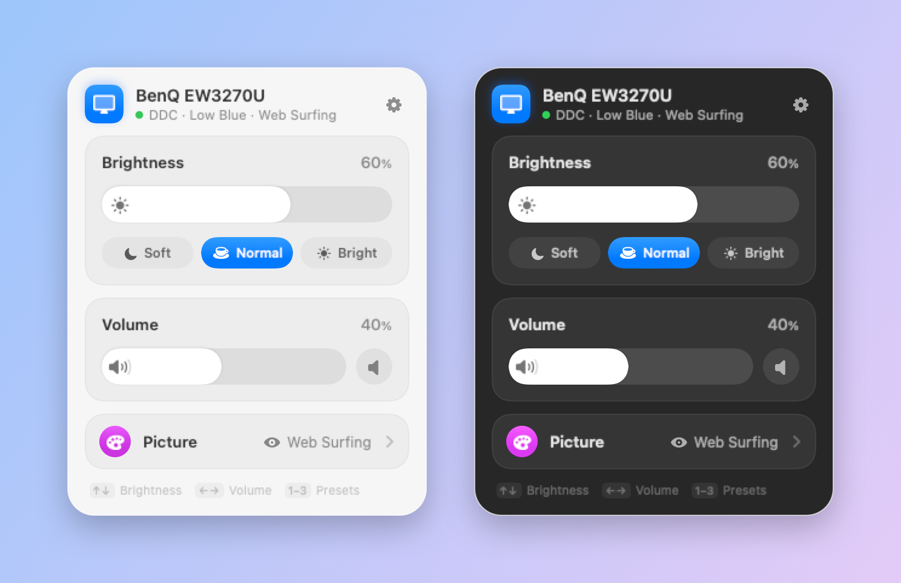
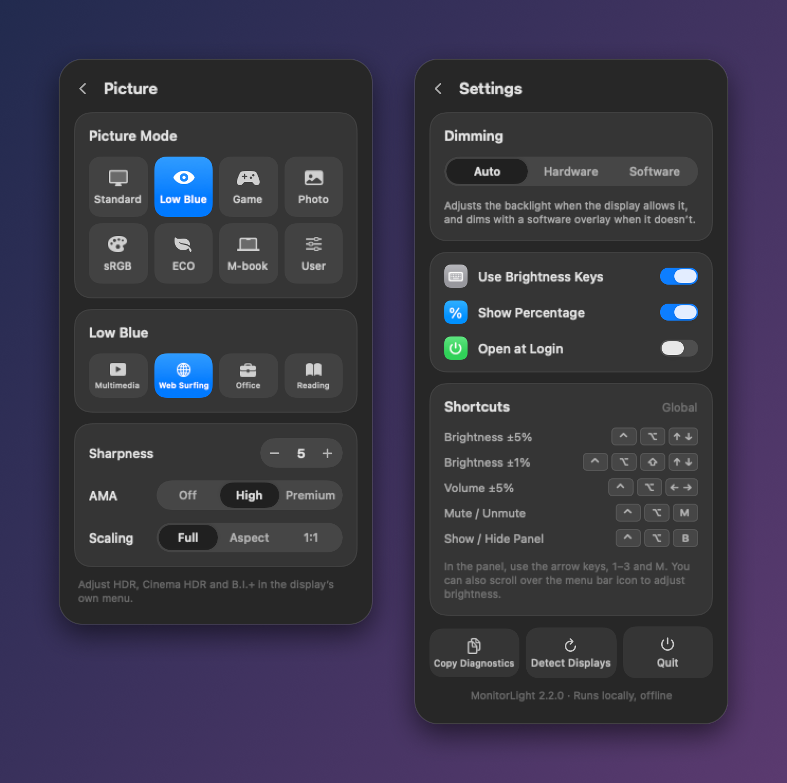
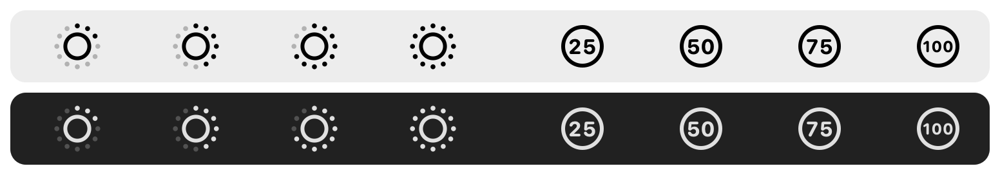

# MonitorLight for BenQ EW3270U

[简体中文](README.zh-CN.md) · [Blog post: why I built it](https://blog.haogre.com/en/2026/10/24/i-brought-my-benq-ew3270u-home-and-wrote-it-a-menu-bar-remote/)

A small macOS menu bar app built for the **BenQ EW3270U** (31.5″ 4K, model ID BNQ7950). It controls the display's **brightness, speaker volume and picture settings** from your Mac, so you don't have to reach for the buttons on the back of the display. Other DDC/CI displays get brightness and volume.



## Download

**[Download MonitorLight.dmg](https://github.com/HAOGRE/MonitorLight/releases/latest/download/MonitorLight.dmg)** (Apple Silicon, macOS 14 or later)

1. Open the DMG and drag **MonitorLight** to **Applications**.
2. The app isn't notarized by Apple, so macOS blocks the first launch. Open **System Settings › Privacy & Security** and click **Open Anyway**, or clear the download flag in Terminal:
   ```sh
   xattr -dr com.apple.quarantine /Applications/MonitorLight.app
   ```
3. Click the sun in the menu bar. To use the keyboard's brightness keys, allow MonitorLight under **Privacy & Security › Accessibility** when it asks.

## Features

- **Brightness and volume** with Control Center–style sliders: drag, click or scroll. Presets for 35%, 60% and 85%, and mute that restores the previous volume.
- **EW3270U picture settings:** picture mode, low blue light scenes (Multimedia, Web Surfing, Office, Reading), sharpness, AMA and scaling. Every value was mapped from the display's own menu and verified on the hardware.
- **Keyboard:** the Mac's brightness keys and global shortcuts, plus the arrow keys, 1–3 and M inside the panel.
- **Menu bar icon:** a ring of dots shows the brightness level; turn on **Show Percentage** to show the number instead. Scroll over the icon to adjust, and right-click it for quick actions.
- **Software dimming fallback:** when the EW3270U locks hardware brightness (B.I.+, HDR or certain picture modes), Auto mode dims with an overlay and switches back to hardware dimming once the display allows it.
- **Liquid Glass panel** on macOS 26 and later. English and Chinese, following the system language.





## Shortcuts

| Shortcut | Action |
| --- | --- |
| ⌃⌥ ↑ / ↓ | Brightness ±5% |
| ⌃⌥⇧ ↑ / ↓ | Brightness ±1% |
| ⌃⌥ ← / → | Volume ±5% |
| ⌃⌥ M | Mute / unmute |
| ⌃⌥ B | Show / hide the panel |
| Brightness keys | Brightness (requires Accessibility permission) |

Inside the panel: ↑/↓ brightness, ←/→ volume, 1–3 presets, M mute, P picture page, ⌘, settings, Esc back or close.

Shortcuts and scripts can use the URL scheme:

```sh
open 'monitorlight://brightness/50'        # 0–100
open 'monitorlight://adjust-brightness/-5' # -100–100
open 'monitorlight://volume/30'
open 'monitorlight://mute'
open 'monitorlight://show'
```

## Dimming modes

- **Auto** (default): adjusts the backlight over DDC/CI and uses a software overlay when the display refuses.
- **Hardware:** DDC/CI only; reports an error instead of falling back.
- **Software:** a translucent overlay. The backlight doesn't change, and screenshots or recordings may show the overlay.

## Compatibility

- **Built and tested for the BenQ EW3270U**, on an M1 Mac with macOS 27, connected over USB-C/DisplayPort.
- Other displays that support DDC/CI should get brightness and volume. Picture settings are only enabled for the EW3270U.
- HDMI on some Macs, docks and adapters doesn't pass DDC/CI through; the software overlay still works.
- Not available on the EW3270U: contrast (writes couldn't be verified), HDR, Cinema HDR and B.I.+ (use the display's menu), and separate sRGB and Rec.709 (the display reports the same mode for both).

## Build from source

Requires Apple Silicon, macOS 14 or later and the Xcode Command Line Tools.

```sh
make test         # localization, protocol, model and interaction tests; renders previews
make install      # build, sign with a local certificate, install to ~/Applications and launch
make dmg          # build/MonitorLight-<version>.dmg
make screenshots  # regenerate docs/images from the real SwiftUI views
make uninstall    # quit and move the app to the Trash
```

`make install` creates a private signing certificate in `~/Library/Application Support/MonitorLight/Signing`. A stable signature keeps the Accessibility permission across updates. It doesn't touch system trust settings or the TCC database.

## How it works

```
Sources/DDCHelper/      DDC/CI protocol and IOAVService transport, in a separate helper process
Sources/MonitorLight/
  App/                  entry point, status item
  Core/                 state model, display settings, DDC client, localization, URL commands
  System/               global shortcuts, brightness keys, software dimming
  UI/                   glass panel, pages, HUD, menu bar icon, components
Tests/                  protocol, model and NSEvent interaction tests; offscreen renders
docs/                   protocol notes and verification log
research/               register capture scripts used to map the EW3270U's menus
```

Every DDC request goes through a time-limited, serialized helper process. A write only counts as successful when an independent read returns the same value. The EW3270U sometimes answers an unsupported query with the previous query's data and a valid checksum, so replies are checked against a sentinel read. See [docs/PROTOCOL.md](docs/PROTOCOL.md).

Apple Silicon DDC uses private IOKit interfaces, so future macOS updates may need changes. The app makes no network requests.

## Credits and license

Display discovery and transport come from [m1ddc](https://github.com/waydabber/m1ddc) (MIT); see [Vendor/README.md](Vendor/README.md). MonitorLight is released under the [MIT License](LICENSE).
