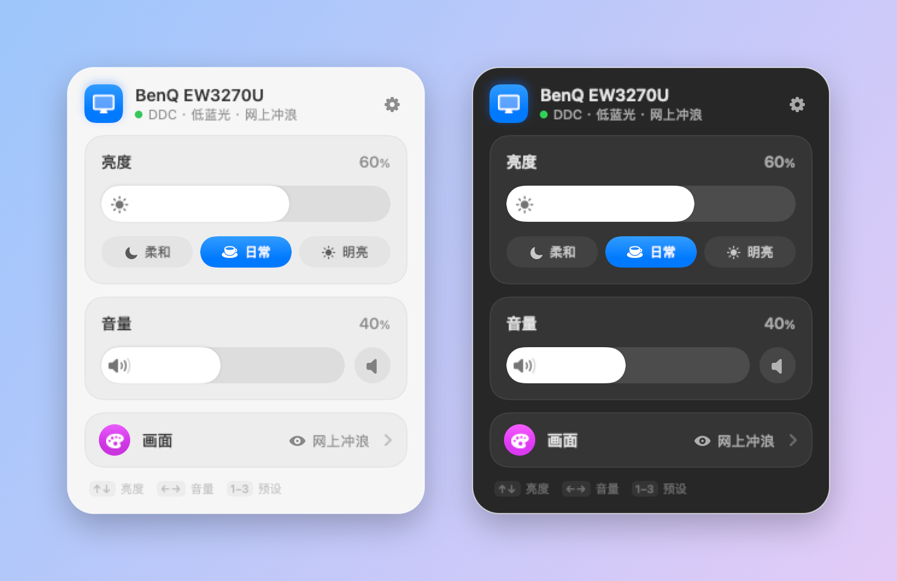
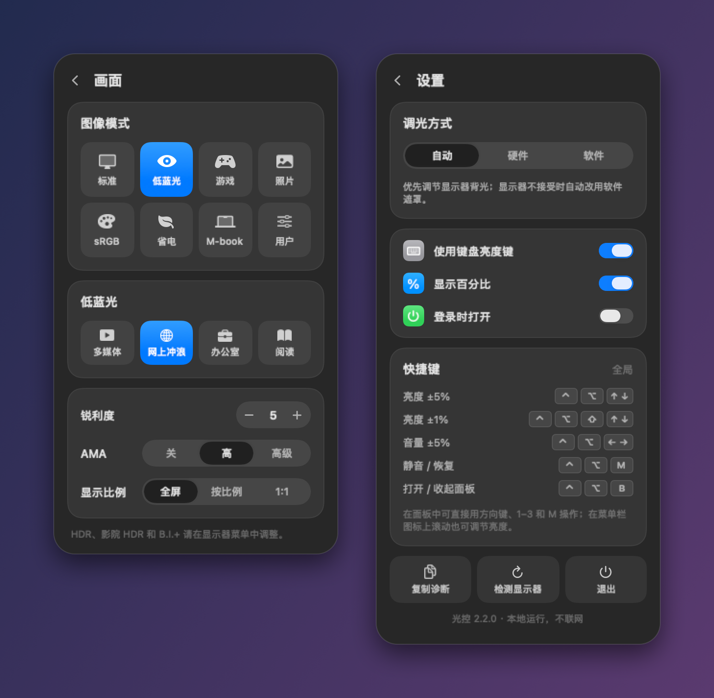

# 光控 MonitorLight · 专为 BenQ EW3270U 打造

[English](README.md)

一个 macOS 菜单栏小工具，专为 **BenQ 明基 EW3270U**（31.5 英寸 4K，型号代码 BNQ7950）开发。在 Mac 上直接调节显示器的**亮度、音量和画面设置**，不用再摸显示器背后的按键。其他支持 DDC/CI 的显示器也能调亮度和音量。



## 下载

**[下载 MonitorLight.dmg](https://github.com/HAOGRE/MonitorLight/releases/latest/download/MonitorLight.dmg)**（Apple Silicon，macOS 14 及以上）

1. 打开 DMG，把“光控”拖进“应用程序”。
2. 应用没有经过 Apple 公证，第一次打开会被系统拦截。请到“系统设置 › 隐私与安全性”中点按“仍要打开”；也可以在终端里清除下载标记：
   ```sh
   xattr -dr com.apple.quarantine /Applications/MonitorLight.app
   ```
3. 点击菜单栏的太阳图标即可使用。想用键盘亮度键调节，请在提示时到“隐私与安全性 › 辅助功能”中允许光控。

## 功能

- **亮度和音量**：控制中心式滑条，可拖动、单击或滚动；35%、60%、85% 三档预设；静音后再点一次恢复原音量。
- **EW3270U 画面设置**：图像模式、低蓝光场景（多媒体、网上冲浪、办公室、阅读）、锐利度、AMA、显示比例。每个数值都对照显示器自带菜单摸清，并在实机上验证过。
- **键盘**：Mac 键盘亮度键、全局快捷键；面板内可用方向键、1–3 和 M。
- **菜单栏图标**：默认用一圈点表示亮度；打开“显示百分比”后改为显示数字。在图标上滚动可调亮度，右键打开快捷菜单。
- **软件调光兜底**：显示器锁定硬件亮度时（B.I.+、HDR 或部分图像模式），自动模式会用遮罩调暗画面；显示器解除锁定后自动恢复硬件调光。
- macOS 26 及以上使用 **Liquid Glass** 面板；支持中英文，跟随系统语言。




## 快捷键

| 快捷键 | 作用 |
| --- | --- |
| ⌃⌥ ↑ / ↓ | 亮度 ±5% |
| ⌃⌥⇧ ↑ / ↓ | 亮度 ±1% |
| ⌃⌥ ← / → | 音量 ±5% |
| ⌃⌥ M | 静音 / 恢复 |
| ⌃⌥ B | 打开 / 收起面板 |
| 键盘亮度键 | 亮度（需要辅助功能权限） |

面板内：↑/↓ 亮度，←/→ 音量，1–3 预设，M 静音，P 画面页，⌘, 设置，Esc 返回或关闭。

快捷指令或脚本可以调用：

```sh
open 'monitorlight://brightness/50'        # 0–100
open 'monitorlight://adjust-brightness/-5' # -100–100
open 'monitorlight://volume/30'
open 'monitorlight://mute'
open 'monitorlight://show'
```

## 调光方式

- **自动**（默认）：通过 DDC/CI 调节背光，显示器拒绝时改用软件遮罩。
- **硬件**：只用 DDC/CI，失败时给出提示，不改用遮罩。
- **软件**：半透明遮罩调暗画面，背光不变；截图和录屏中可能看到遮罩。

## 兼容性

- **专为 BenQ EW3270U 开发和测试**：M1 Mac、macOS 27，USB-C／DisplayPort 连接。
- 其他支持 DDC/CI 的显示器应该可以调亮度和音量。画面设置只对 EW3270U 开放，每个数值都在实机上验证过。
- 部分 Mac 的 HDMI 口、扩展坞和转接器不转发 DDC/CI，这时仍可使用软件遮罩。
- 对比度写入无法验证，因此没有提供；HDR、影院 HDR 和 B.I.+ 仍需在显示器菜单中调整；sRGB 与 Rec.709 读回同一个模式，无法分别选择。

## 从源码构建

需要 Apple Silicon、macOS 14 及以上，以及 Xcode Command Line Tools。

```sh
make test         # 本地化、协议、模型、交互测试，并渲染预览
make install      # 构建、用本机证书签名、安装到 ~/Applications 并启动
make dmg          # 生成 build/MonitorLight-<版本>.dmg
make screenshots  # 用真实界面代码重新生成 docs/images 中的截图
make uninstall    # 退出并移到废纸篓
```

`make install` 会在 `~/Library/Application Support/MonitorLight/Signing` 中创建本机专用的签名证书。签名身份保持不变，更新后辅助功能权限仍然有效。脚本不会修改系统信任设置或 TCC 数据库。

## 实现

```
Sources/DDCHelper/      DDC/CI 协议与 IOAVService 通信（独立辅助进程）
Sources/MonitorLight/
  App/                  入口、菜单栏项
  Core/                 状态模型、画面设置、DDC 客户端、本地化、URL 命令
  System/               全局快捷键、键盘亮度键、软件调光
  UI/                   玻璃面板、各页面、HUD、菜单栏图标、通用组件
Tests/                  协议、模型、真实 NSEvent 交互测试，离屏渲染
docs/                   协议记录与验证记录
research/               摸清 EW3270U 菜单时使用的寄存器采集脚本
```

所有 DDC 请求都在有超时、串行加锁的辅助进程中执行；只有独立读回一致才算写入成功。EW3270U 有时会把上一个查询的数据配上正确的校验和，回复给不支持的查询，所以每次读取都会先用哨兵值校验。详见 [docs/PROTOCOL.md](docs/PROTOCOL.md)。

Apple Silicon 上的 DDC 通信依赖私有 IOKit 接口，以后的 macOS 更新可能需要适配。应用不联网。

## 致谢与许可

显示器发现与传输代码来自 [m1ddc](https://github.com/waydabber/m1ddc)（MIT），详见 [Vendor/README.md](Vendor/README.md)。光控以 [MIT 许可证](LICENSE) 开源。
